# Label Generator for Gridfinity Bins and Storage Boxes

Welcome to the **Label Generator for Gridfinity**! This project provides parametrically designed labels created in **OpenSCAD**. These labels are tailored for the storage solutions designed by [Pred](https://www.printables.com/@Pred_457770) and can be used with his **Gridfinity boxes and bins**. 

The labels are fully customizable and easy to configure online, making it simple to adapt them to your specific needs.


### Fully Parametric Labels
- Designed in OpenSCAD for maximum flexibility.
- Easily configurable with dimensions, fonts, styles, and more!

### Online Customization
You can customize the labels directly in your browser using Makerworld's **online customization feature**:
- **Labels for Gridfinity Bins:** [Find them here](https://makerworld.com/en/models/769441#profileId-705079)
- **Labels for Storage Boxes:** [Find them here](https://makerworld.com/en/models/738730#profileId-694230)

### Variety of Attachment Options
The bin label generator supports bolts (every head with every drive and tip), nuts, washers, standoffs, wall anchors and heat set inserts. See [Supported parts](#supported-parts) for a picture of each one.

New parts are regularly added to the library. Contributions are welcome!

## Supported parts
Every part and combination the bin label generator (`gridfinity_bin_label.scad`) can draw, rendered with the default colors (white content on a black label).

<!-- gallery:start -->
<!-- Generated by tools/generate_gallery.py, do not edit by hand. -->

### Bolt heads

Shown with the hex socket drive. Every head can be combined with every drive and tip below.

|   |   |   |
|:---:|:---:|:---:|
| <br>Socket head | <br>Pan head | <br>Mushroom head |
| <br>Flat head | <br>Countersunk | 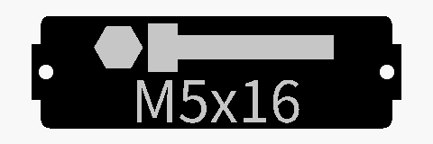<br>Hex head |
| 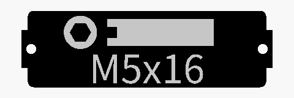<br>Grub screw |   |   |

### Bolt drives

Shown on a pan head. Ignored for hex head bolts.

|   |   |   |
|:---:|:---:|:---:|
| <br>Hex socket | <br>Phillips | 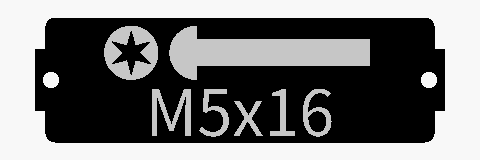<br>Torx |
| <br>Torx TR | 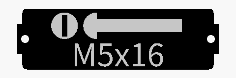<br>Slotted |   |

### Bolt tips

Shown on a pan head. Ignored for grub screws.

|   |   |   |
|:---:|:---:|:---:|
| <br>Machine | <br>Wood |   |

### All bolt combinations

Every head with every drive and tip, 57 in total.

<details>
<summary>Socket head (10)</summary>

|   |   |   |
|:---:|:---:|:---:|
| <br>Hex socket, Machine | <br>Hex socket, Wood | <br>Phillips, Machine |
| <br>Phillips, Wood | <br>Torx, Machine | <br>Torx, Wood |
| <br>Torx TR, Machine | <br>Torx TR, Wood | 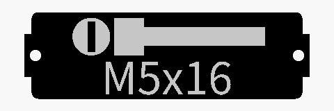<br>Slotted, Machine |
| 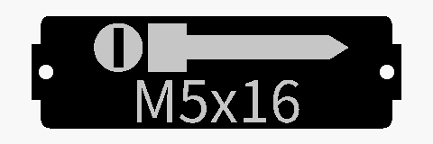<br>Slotted, Wood |   |   |

</details>

<details>
<summary>Pan head (10)</summary>

|   |   |   |
|:---:|:---:|:---:|
| <br>Hex socket, Machine | <br>Hex socket, Wood | <br>Phillips, Machine |
| <br>Phillips, Wood | <br>Torx, Machine | <br>Torx, Wood |
| <br>Torx TR, Machine | <br>Torx TR, Wood | <br>Slotted, Machine |
| 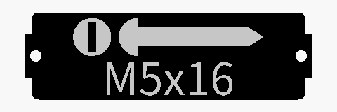<br>Slotted, Wood |   |   |

</details>

<details>
<summary>Mushroom head (10)</summary>

|   |   |   |
|:---:|:---:|:---:|
| <br>Hex socket, Machine | <br>Hex socket, Wood | <br>Phillips, Machine |
| <br>Phillips, Wood | 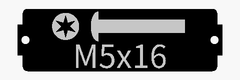<br>Torx, Machine | <br>Torx, Wood |
| 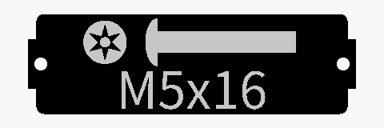<br>Torx TR, Machine | <br>Torx TR, Wood | 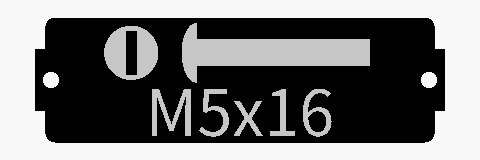<br>Slotted, Machine |
| 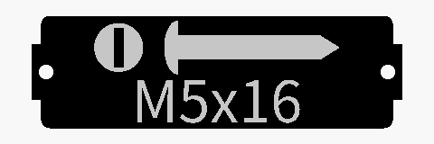<br>Slotted, Wood |   |   |

</details>

<details>
<summary>Flat head (10)</summary>

|   |   |   |
|:---:|:---:|:---:|
| <br>Hex socket, Machine | <br>Hex socket, Wood | <br>Phillips, Machine |
| <br>Phillips, Wood | 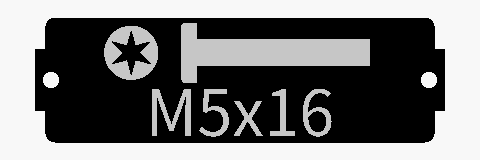<br>Torx, Machine | <br>Torx, Wood |
| <br>Torx TR, Machine | <br>Torx TR, Wood | <br>Slotted, Machine |
| 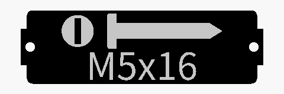<br>Slotted, Wood |   |   |

</details>

<details>
<summary>Countersunk (10)</summary>

|   |   |   |
|:---:|:---:|:---:|
| <br>Hex socket, Machine | <br>Hex socket, Wood | <br>Phillips, Machine |
| <br>Phillips, Wood | 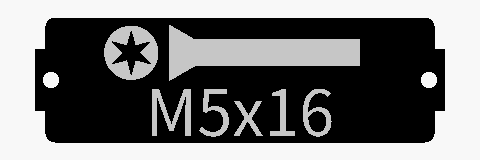<br>Torx, Machine | <br>Torx, Wood |
| <br>Torx TR, Machine | <br>Torx TR, Wood | 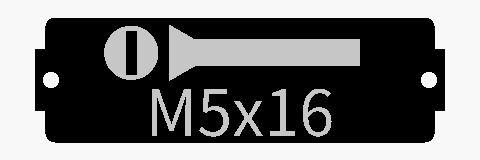<br>Slotted, Machine |
| 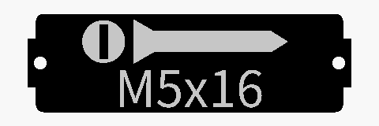<br>Slotted, Wood |   |   |

</details>

<details>
<summary>Hex head (2)</summary>

|   |   |   |
|:---:|:---:|:---:|
| <br>Machine | 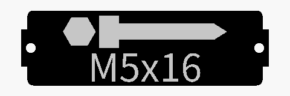<br>Wood |   |

</details>

<details>
<summary>Grub screw (5)</summary>

|   |   |   |
|:---:|:---:|:---:|
| <br>Hex socket | 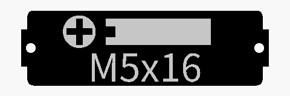<br>Phillips | 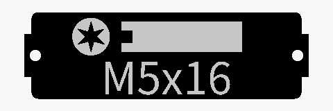<br>Torx |
| 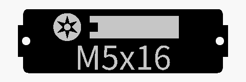<br>Torx TR | 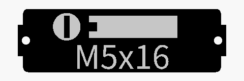<br>Slotted |   |

</details>

### Nuts

|   |   |   |
|:---:|:---:|:---:|
| 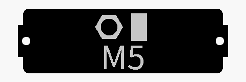<br>Standard | 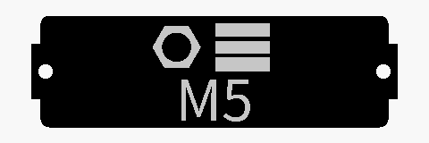<br>Tall | 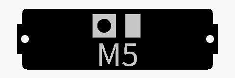<br>Square |
| 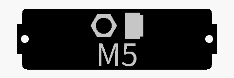<br>Lock | 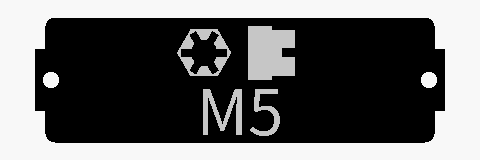<br>Castle | 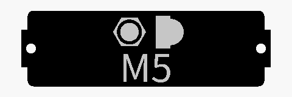<br>Cap |
| 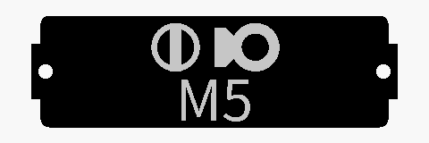<br>Eye | 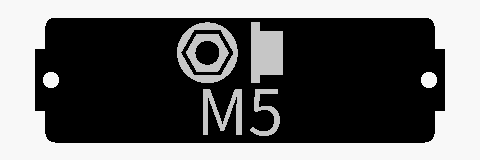<br>Disc | 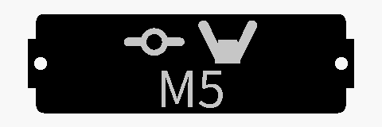<br>Wing |
| 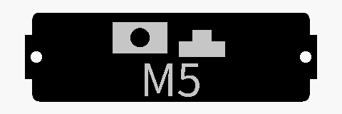<br>Slide-in T-nut | 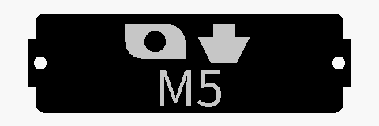<br>Hammer |   |

### Washers

|   |   |   |
|:---:|:---:|:---:|
| 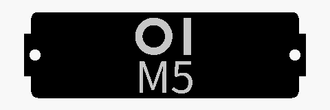<br>Standard | 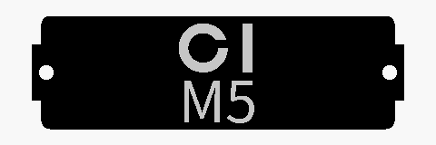<br>Spring |   |

### Standoffs

|   |   |   |
|:---:|:---:|:---:|
| <br>Male-female | <br>Female-female | 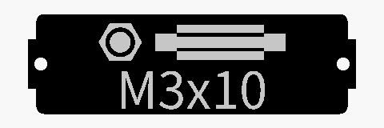<br>Male-male |

### Other

|   |   |   |
|:---:|:---:|:---:|
| 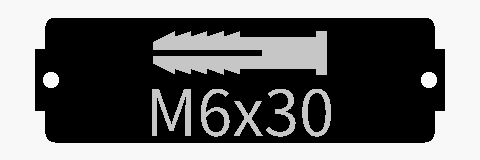<br>Wall anchor | 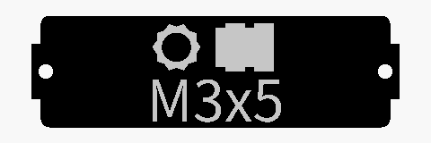<br>Heat set insert | <br>Custom text |
| 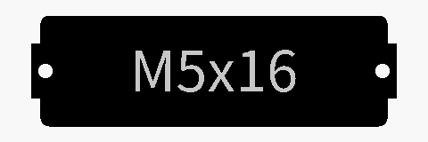<br>None |   |   |

<!-- gallery:end -->

## Storage Boxes en Bins by Pred
These labels are specifically designed to fit the great models made by pred. See Pred's models here:
- [Gridfinity Storage Box (Parametric)](https://www.printables.com/model/543553-gridfinity-storage-box-by-pred-now-parametric)
- [Gridfinity Bin with Printable Label (Parametric)](https://www.printables.com/model/592545-gridfinity-bin-with-printable-label-by-pred-parame)


## How to Contribute
Feel free to:
- Add new options for mounting or design.
- Submit pull requests with your improvements.

### Adding a new part
1. Add the part to `gridfinity_bin_label.scad`: a module for the icon, an entry in the matching customizer dropdown (e.g. `Nut_type`) and a branch in `choose_Part_version`.
2. **Update the supported parts on this page.** Run the gallery script, it reads the dropdowns, renders a picture of every part and combination to `docs/gallery/` and rewrites the [Supported parts](#supported-parts) section:
   ```sh
   python3 tools/generate_gallery.py
   ```
   It needs [OpenSCAD](https://openscad.org/) on the `PATH` (or in the `OPENSCAD` environment variable).
3. Commit the changed pictures and `README.md` together with your part.

Your ideas and contributions help expand this library and make it more versatile for all users.
