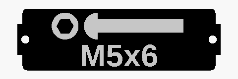
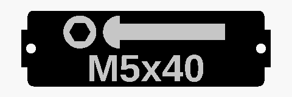
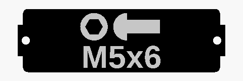
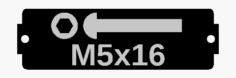
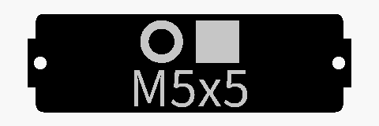
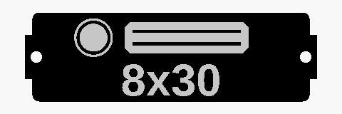
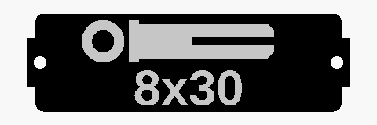
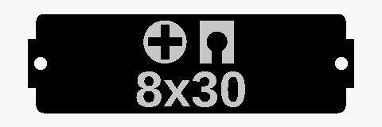
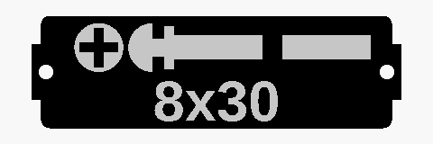

# Label Generator for Gridfinity Bins and Storage Boxes

Welcome to the **Label Generator for Gridfinity**! This project provides parametrically designed labels created in **OpenSCAD**. These labels are tailored for the storage solutions designed by [Pred](https://www.printables.com/@Pred_457770) and can be used with his **Gridfinity boxes and bins**. 

The labels are fully customizable and easy to configure online, making it simple to adapt them to your specific needs.


### Fully Parametric Labels
- Designed in OpenSCAD for maximum flexibility.
- Easily configurable with dimensions, fonts, styles, and more!

### Online Customization
Configure a label in your browser, no account needed, at
**[laurensguijt.github.io/Label-Generator-Gridfinity](https://laurensguijt.github.io/Label-Generator-Gridfinity/)**.
It runs OpenSCAD in the browser, nothing is uploaded, and the link keeps your
settings so you can share or bookmark a label. The file you download is a plain
STL, so print it in two colours with a filament change at the first layer above
the label surface.

Or use Makerworld's **online customization feature**, which hands you a ready
made multi colour file and has every font available:
- **Labels for Gridfinity Bins:** [Find them here](https://makerworld.com/en/models/769441#profileId-705079)
- **Labels for Storage Boxes:** [Find them here](https://makerworld.com/en/models/738730#profileId-694230)

### Variety of Attachment Options
The bin label generator supports bolts (every head with every drive and tip), nuts, washers, standoffs, wall anchors, heat set inserts, threaded rods, compression springs and furniture hardware (wooden dowels, expansion sleeves, cam lock nuts and bolts). See [Supported parts](#supported-parts) for a picture of each one.

New parts are regularly added to the library. Contributions are welcome!

## Adding a part

Every part lives in `gridfinity_bin_label.scad` and needs four things, all in
that one file. Nothing else has to be touched: the gallery script reads the
table in step 2, and the GitHub Action renders the pictures and updates the
[Supported parts](#supported-parts) section by itself.

The example below adds a rivet to the **Other** category.

### 1. Put it in the dropdown

Find the dropdown of the category you are adding to and add the name. The
customizer on MakerWorld builds its menus from these comments, so the `// [...]`
has to stay exactly in this shape.

```scad
/* [Other (only used when Category is Other)] */
Other_type = "Wall anchor"; // [Wall anchor, Heat set insert, Threaded rod, Compression spring, Rivet, Custom text, None]
```

### 2. Add a row to `parts`

The `parts` table near the top of the file says how a part behaves. A row is
`[category, type, icon, text, gallery]`:

| column | what it does |
|---|---|
| `category` | the dropdown it belongs to: `Bolt`, `Nut`, `Washer`, `Standoff`, `Furniture` or `Other` |
| `type` | the name you just added, or `"*"` for every type in the category |
| `icon` | the size in mm the icon is drawn at when **Icon_length** is `Fixed`, or `undef` to always draw it at the real length |
| `text` | what is written under the icon: `"size"` is `M5x16`, `"diameter"` is `M5`, `"optional"` is `M5x16` or `M5` when there is no length, `"centered"` is `M5x16` without an icon, `"custom"` is the custom text lines |
| `gallery` | the size the README picture is rendered at: `[diameter]` or `[diameter, length]` |

A row for the type itself wins over the category's `"*"` row, so you only need
your own row when the part differs from the rest of its category. A new nut, for
instance, is covered by `["Nut", "*", ...]` and needs no row at all.

```scad
parts = [
    // ...
    ["Other",     "Rivet",                8,    "size",     ["M4", 8]],
];
```

### 3. Add a line to `draw_icon`

One line, next to the other parts of the category:

```scad
    else if (key == "Other/Rivet")              Rivet(icon_len, width, height);
```

### 4. Write the icon module

Every icon module starts with the same three parameters, whether it uses them or
not. `icon_len` is the length to draw at — **use this and never `hardware_length`
directly**, otherwise the Icon_length setting silently does nothing for your
part. The text under the icon is not your job, step 2 takes care of it.

Draw at `z = height` with a thickness of `text_height`, and keep the icon above
the text by translating it up by `vertical_offset`. Most parts show a top view on
the left and a side view to the right of it:

```scad
// Rivet: round head seen from above, with the shank next to it
module Rivet(icon_len, width, height, vertical_offset = 2.5) {
    translate([-1.5, vertical_offset, height]) {
        // top view
        cylinder(h=text_height, d=5);
        // side view
        translate([4, -1.25, 0])
            cube([icon_len, 2.5, text_height]);
    }
}
```

A label is 11.5 mm wide and 35.8 mm long at `Y_units = 1`, with mounting holes
1 mm in from each end. Parts that scale with their length clamp the drawing to
`20 * Y_units` so a long one cannot run off the label; `drawBoltStem()` does that
for you and splits the icon in two when it no longer fits.

### Check it

Open the file in OpenSCAD, pick your part in the customizer and look at it at a
few lengths, with **Icon_length** on both `Fixed` and `Real length`. Open a pull
request and the "Parts gallery" Action renders every part and attaches the
pictures, so you can see yours next to the rest before it is merged.

Running the gallery script yourself is optional:

```sh
python3 tools/generate_gallery.py
```

It needs [OpenSCAD](https://openscad.org/) on the `PATH` (or in the `OPENSCAD`
environment variable), and a recent build with the manifold backend so the
pictures match the ones the Action commits.

## Supported parts
Every part and combination the bin label generator (`gridfinity_bin_label.scad`) can draw, rendered with the default colors (white content on a black label).

<!-- gallery:start -->
<!-- Generated by tools/generate_gallery.py, do not edit by hand. -->

### Bolt heads

Shown with the hex socket drive. Every head can be combined with every drive and tip below.

|   |   |   |
|:---:|:---:|:---:|
| <br>Socket head | <br>Pan head | <br>Mushroom head |
| <br>Flat head | <br>Countersunk | <br>Hex head |
| <br>Grub screw |   |   |

### Bolt drives

Shown on a pan head. Ignored for hex head bolts.

|   |   |   |
|:---:|:---:|:---:|
| <br>Hex socket | <br>Phillips | <br>Torx |
| <br>Torx TR | <br>Slotted |   |

### Bolt tips

Shown on a pan head. Ignored for grub screws.

|   |   |   |
|:---:|:---:|:---:|
| <br>Machine | <br>Wood |   |

### Icon length

Fixed (the default) draws every part at the same size, the length only shows in the text. Real length scales the icon with the length, long parts get a split icon.

|   |   |   |
|:---:|:---:|:---:|
| <br>Fixed, M5x6 | <br>Fixed, M5x16 | <br>Fixed, M5x40 |
| <br>Real length, M5x6 | <br>Real length, M5x16 | <br>Real length, M5x40 |

### All bolt combinations

Every head with every drive and tip, 57 in total.

<details>
<summary>Socket head (10)</summary>

|   |   |   |
|:---:|:---:|:---:|
| <br>Hex socket, Machine | <br>Hex socket, Wood | <br>Phillips, Machine |
| <br>Phillips, Wood | <br>Torx, Machine | <br>Torx, Wood |
| <br>Torx TR, Machine | <br>Torx TR, Wood | <br>Slotted, Machine |
| <br>Slotted, Wood |   |   |

</details>

<details>
<summary>Pan head (10)</summary>

|   |   |   |
|:---:|:---:|:---:|
| <br>Hex socket, Machine | <br>Hex socket, Wood | <br>Phillips, Machine |
| <br>Phillips, Wood | <br>Torx, Machine | <br>Torx, Wood |
| <br>Torx TR, Machine | <br>Torx TR, Wood | <br>Slotted, Machine |
| <br>Slotted, Wood |   |   |

</details>

<details>
<summary>Mushroom head (10)</summary>

|   |   |   |
|:---:|:---:|:---:|
| <br>Hex socket, Machine | <br>Hex socket, Wood | <br>Phillips, Machine |
| <br>Phillips, Wood | <br>Torx, Machine | <br>Torx, Wood |
| <br>Torx TR, Machine | <br>Torx TR, Wood | <br>Slotted, Machine |
| <br>Slotted, Wood |   |   |

</details>

<details>
<summary>Flat head (10)</summary>

|   |   |   |
|:---:|:---:|:---:|
| <br>Hex socket, Machine | <br>Hex socket, Wood | <br>Phillips, Machine |
| <br>Phillips, Wood | <br>Torx, Machine | <br>Torx, Wood |
| <br>Torx TR, Machine | <br>Torx TR, Wood | <br>Slotted, Machine |
| <br>Slotted, Wood |   |   |

</details>

<details>
<summary>Countersunk (10)</summary>

|   |   |   |
|:---:|:---:|:---:|
| <br>Hex socket, Machine | <br>Hex socket, Wood | <br>Phillips, Machine |
| <br>Phillips, Wood | <br>Torx, Machine | <br>Torx, Wood |
| <br>Torx TR, Machine | <br>Torx TR, Wood | <br>Slotted, Machine |
| <br>Slotted, Wood |   |   |

</details>

<details>
<summary>Hex head (2)</summary>

|   |   |   |
|:---:|:---:|:---:|
| <br>Machine | <br>Wood |   |

</details>

<details>
<summary>Grub screw (5)</summary>

|   |   |   |
|:---:|:---:|:---:|
| <br>Hex socket | <br>Phillips | <br>Torx |
| <br>Torx TR | <br>Slotted |   |

</details>

### Nuts

|   |   |   |
|:---:|:---:|:---:|
| <br>Standard | <br>Tall | <br>Square |
| <br>Lock | <br>Castle | <br>Cap |
| <br>Eye | <br>Disc | <br>Wing |
| <br>Slide-in T-nut | <br>Hammer |   |

### Washers

|   |   |   |
|:---:|:---:|:---:|
| <br>Standard | <br>Spring | <br>Spacer |

### Standoffs

|   |   |   |
|:---:|:---:|:---:|
| <br>Male-female | <br>Female-female | <br>Male-male |

### Furniture hardware

|   |   |   |
|:---:|:---:|:---:|
| <br>Wooden dowel | <br>Expansion sleeve | <br>Cam lock nut |
| <br>Cam lock bolt |   |   |

### Other

|   |   |   |
|:---:|:---:|:---:|
| <br>Wall anchor | <br>Heat set insert | <br>Threaded rod |
| <br>Compression spring | <br>Custom text | <br>None |

<!-- gallery:end -->

## Storage Boxes en Bins by Pred
These labels are specifically designed to fit the great models made by pred. See Pred's models here:
- [Gridfinity Storage Box (Parametric)](https://www.printables.com/model/543553-gridfinity-storage-box-by-pred-now-parametric)
- [Gridfinity Bin with Printable Label (Parametric)](https://www.printables.com/model/592545-gridfinity-bin-with-printable-label-by-pred-parame)


## How to Contribute
Feel free to:
- Add new options for mounting or design.
- Submit pull requests with your improvements.

See [Adding a part](#adding-a-part) for the four steps, and please leave the
generated files alone: the pictures in `docs/gallery/` and the
[Supported parts](#supported-parts) section are written by the Action.

Your ideas and contributions help expand this library and make it more versatile for all users.
